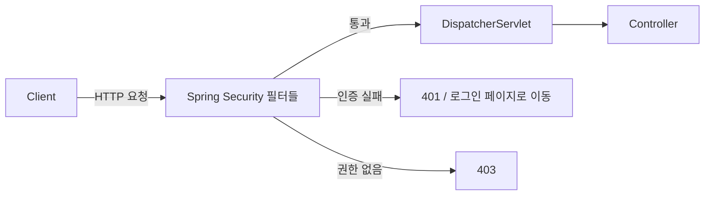

# 01. Spring Security 핵심 개념

## 학습 목표

- 인증(Authentication)과 인가(Authorization)의 차이를 설명할 수 있다.
- 401 Unauthorized 와 403 Forbidden 을 구분할 수 있다.
- Principal, Credentials, Authority, SecurityContext 가 무엇인지 안다.

코드를 보기 전에 용어부터 정리하자. Spring Security 문서와 에러 메시지는 이 용어들로 가득하다.

## 1. 인증 vs 인가

회사 건물에 들어가는 상황을 떠올려 보자.

| | 인증 (Authentication) | 인가 (Authorization) |
|---|---|---|
| 질문 | **너 누구야?** | **너 이거 해도 돼?** |
| 건물 비유 | 출입 게이트에서 사원증을 찍는다 | 서버실 문은 인프라팀 사원증만 열린다 |
| 웹 예시 | 아이디/비밀번호로 로그인 | ADMIN 만 회원 목록을 볼 수 있다 |
| 실패 시 | **401 Unauthorized** | **403 Forbidden** |
| 순서 | 먼저 | 인증 이후 |

> HTTP 상태 코드 이름이 헷갈리게 지어졌다. **401 Unauthorized 는 사실 "Unauthenticated(인증 안 됨)"** 라는 뜻이고,
> **403 Forbidden 이 "권한 없음"** 이다. 이 프로젝트에서 직접 확인해 보자.
>
> - 로그인하지 않고 `/api/me` 호출 → 401 (누군지 모르겠다)
> - USER 로 로그인해서 `/api/admin/members` 호출 → 403 (누군지는 알지만 권한이 없다)

브라우저 화면에서는 401 대신 **로그인 페이지로 리다이렉트(302)** 하는 경우가 많다. "누군지 모르겠으니 로그인하고 와" 라는 의미는 같다.

## 2. 핵심 용어

### Principal - "누구"

인증된 사용자 자체를 가리킨다. 보통 사용자 객체(이 프로젝트에서는 `MemberPrincipal`)나 username 이다.

### Credentials - "증명 수단"

비밀번호처럼 신원을 증명하는 정보. 인증이 끝나면 보안을 위해 지워진다.

### GrantedAuthority - "권한"

사용자가 가진 권한을 나타내는 **문자열**이다. 예: `ROLE_ADMIN`, `member:read`

- **Role(역할)** 은 `ROLE_` 접두사가 붙은 Authority 다. `hasRole("ADMIN")` 은 `hasAuthority("ROLE_ADMIN")` 과 같다. (07장에서 자세히)

### Authentication - "인증 정보 묶음"

위 세 가지를 담는 객체다.

```java
public interface Authentication extends Principal, Serializable {
    Collection<? extends GrantedAuthority> getAuthorities(); // 권한 목록
    Object getCredentials();                                  // 비밀번호 등
    Object getPrincipal();                                    // 사용자
    boolean isAuthenticated();                                // 인증 완료 여부
    ...
}
```

같은 객체가 두 가지 상태로 쓰인다.

1. **인증 전**: "이 아이디/비밀번호로 인증해 주세요" 라는 **요청서** (`isAuthenticated() == false`)
2. **인증 후**: "이 사람은 인증되었고 권한은 이것입니다" 라는 **결과** (`isAuthenticated() == true`)

### SecurityContext / SecurityContextHolder - "지금 요청의 사용자는?"

인증 결과(`Authentication`)를 보관하는 상자가 `SecurityContext`, 그 상자를 어디서든 꺼낼 수 있게 해주는 것이 `SecurityContextHolder` 다.

```java
Authentication authentication = SecurityContextHolder.getContext().getAuthentication();
String username = authentication.getName();
```

```
SecurityContextHolder
 └── SecurityContext
      └── Authentication
           ├── Principal       (MemberPrincipal: admin)
           ├── Credentials     (인증 후에는 null)
           └── Authorities     ([ROLE_ADMIN])
```

`SecurityContextHolder` 는 기본적으로 **ThreadLocal** 에 저장한다. 하나의 요청은 하나의 스레드에서 처리되므로,
컨트롤러든 서비스든 같은 요청 안이라면 어디서든 현재 사용자를 꺼낼 수 있다.

## 3. Spring Security 가 해주는 일

| 영역 | 예 | 다루는 장 |
|------|-----|-----------|
| 인증 | 폼 로그인, HTTP Basic, JWT, OAuth2 로그인 | 05, 06, 09 |
| 인가 | URL 별 접근 제어, 메서드 단위 접근 제어 | 07 |
| 비밀번호 보관 | BCrypt 등 안전한 해시 | 04 |
| 공격 방어 | CSRF, 세션 고정 공격, 클릭재킹(보안 헤더) | 06, 08 |

그리고 이 모든 것을 **서블릿 필터(Filter)** 로 구현한다.
요청이 컨트롤러(DispatcherServlet)에 도착하기 **전에** 필터들이 먼저 검사하고, 통과한 요청만 컨트롤러로 보낸다.



필터 구조는 03장에서 자세히 본다.

## 4. 이 강의에서 만드는 것

하나의 애플리케이션 안에 성격이 다른 두 가지 인증 방식을 함께 구성한다.

| | 화면 (`/`, `/me`, `/admin/**`) | REST API (`/api/**`) |
|---|---|---|
| 클라이언트 | 브라우저 | 앱, SPA, 다른 서버 |
| 인증 방식 | 폼 로그인 + 세션(JSESSIONID 쿠키) | JWT Bearer 토큰 |
| 상태 | Stateful | Stateless |
| CSRF 방어 | 켬 | 끔 |
| 다루는 장 | 05 ~ 08 | 09 |

## 확인 문제

1. 로그인한 USER 가 관리자 페이지에 접근했다. 인증과 인가 중 어느 단계에서 실패했고, 상태 코드는?
2. `hasRole("ADMIN")` 은 실제로 어떤 Authority 문자열을 검사할까?
3. 서비스 계층에서 현재 로그인한 사용자의 username 을 얻으려면?

<details>
<summary>정답</summary>

1. 인가 단계. 403 Forbidden.
2. `ROLE_ADMIN`
3. `SecurityContextHolder.getContext().getAuthentication().getName()`

</details>

## 정리

- **인증**은 "누구인가", **인가**는 "무엇을 할 수 있는가". 실패하면 각각 401, 403.
- 인증 결과는 `Authentication` 객체이며 `SecurityContextHolder` 에 보관된다.
- Spring Security 는 서블릿 필터로 동작한다.

---

| 이전 | 목차 | 다음 |
|:-----|:----:|-----:|
| [← 00. 실습 환경 준비](00-setup.md) | [목차](../README.md) | [02. 자동 구성 →](02-auto-configuration.md) |
