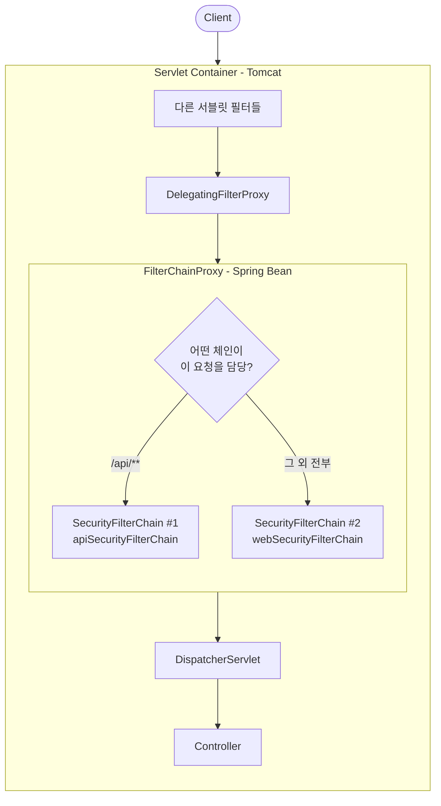
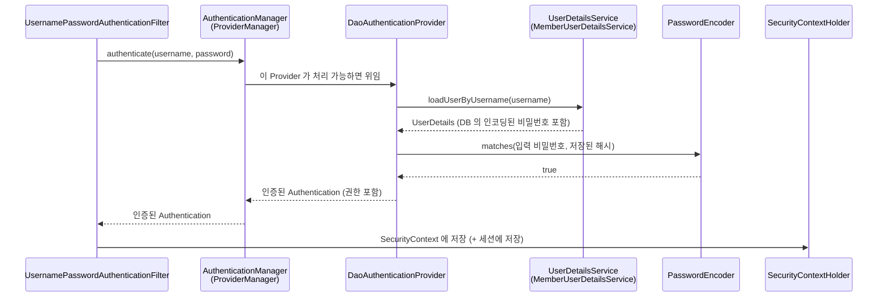
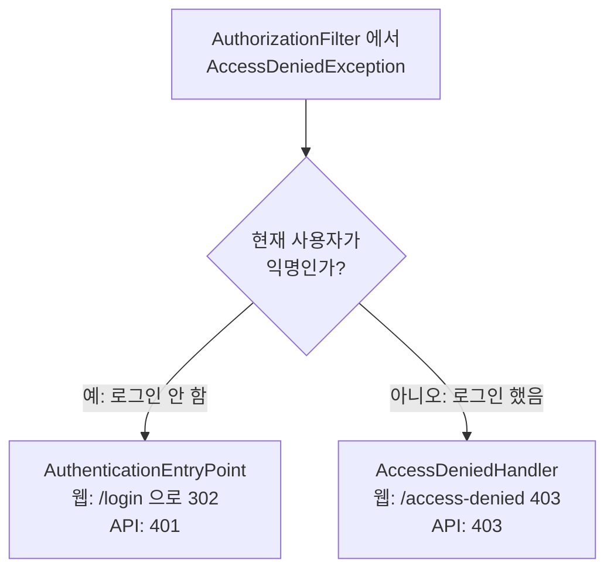

# 03. 아키텍처 - 필터 체인

## 학습 목표

- 요청이 Spring Security 를 통과하는 경로(DelegatingFilterProxy → FilterChainProxy → SecurityFilterChain)를 설명할 수 있다.
- 하나의 애플리케이션에 여러 `SecurityFilterChain` 을 두는 방법을 안다.
- 아이디/비밀번호 인증이 어떤 객체들을 거쳐 처리되는지 안다.

## 1. 큰 그림



| 구성 요소 | 역할 |
|-----------|------|
| **DelegatingFilterProxy** | 서블릿 컨테이너(Tomcat)에 등록되는 평범한 필터. 스스로는 아무것도 하지 않고 Spring 컨테이너의 빈(`springSecurityFilterChain`)에게 일을 넘긴다. 서블릿 세계와 Spring 세계를 잇는 다리. |
| **FilterChainProxy** | Spring Security 의 진짜 입구. 요청 URL 을 보고 **처음으로 매칭되는** `SecurityFilterChain` 하나를 골라 실행한다. |
| **SecurityFilterChain** | 실제 보안 필터들의 목록. 우리가 `HttpSecurity` 로 만드는 것이 바로 이것이다. |

> 왜 이렇게 복잡할까? Tomcat 은 Spring 빈을 모른다. 그래서 Tomcat 에는 "대리인(Proxy)" 만 등록해 두고,
> 실제 필터는 Spring 빈으로 만들어 의존성 주입, AOP 등 Spring 의 기능을 모두 쓸 수 있게 한 것이다.

## 2. 우리 프로젝트의 필터 체인 확인하기

로그 레벨을 올려서 실제로 어떤 필터가 등록되었는지 보자.

```bash
./gradlew bootRun --args='--logging.level.org.springframework.security.web.DefaultSecurityFilterChain=DEBUG'
```

실제 출력 (보기 좋게 줄바꿈):

```
Will secure Or [PathPattern [/api/**]] with filters:
  DisableEncodeUrlFilter, WebAsyncManagerIntegrationFilter, SecurityContextHolderFilter,
  HeaderWriterFilter, LogoutFilter, OAuth2ProtectedResourceMetadataFilter,
  BearerTokenAuthenticationFilter, RequestCacheAwareFilter, SecurityContextHolderAwareRequestFilter,
  AnonymousAuthenticationFilter, SessionManagementFilter, ExceptionTranslationFilter, AuthorizationFilter

Will secure any request with filters:
  DisableEncodeUrlFilter, WebAsyncManagerIntegrationFilter, SecurityContextHolderFilter,
  HeaderWriterFilter, CsrfFilter, LogoutFilter, UsernamePasswordAuthenticationFilter,
  RequestCacheAwareFilter, SecurityContextHolderAwareRequestFilter,
  AnonymousAuthenticationFilter, ExceptionTranslationFilter, AuthorizationFilter
```

두 체인을 비교해 보면 설정의 차이가 그대로 드러난다.

| 필터 | API 체인 | 웹 체인 | 이유 |
|------|:-------:|:------:|------|
| `CsrfFilter` | X | O | API 체인은 `csrf.disable()` (08장) |
| `UsernamePasswordAuthenticationFilter` | X | O | 웹 체인만 `formLogin()` (06장) |
| `BearerTokenAuthenticationFilter` | O | X | API 체인만 `oauth2ResourceServer().jwt()` (09장) |

### 주요 필터의 역할 (요청이 지나가는 순서)

| 필터 | 하는 일 |
|------|---------|
| `SecurityContextHolderFilter` | 세션 등에 저장된 `SecurityContext` 를 불러와 `SecurityContextHolder` 에 넣는다. 요청이 끝나면 비운다. |
| `HeaderWriterFilter` | 응답에 보안 헤더(`X-Frame-Options`, `X-Content-Type-Options` 등)를 추가한다. |
| `CsrfFilter` | POST/PUT/DELETE 요청의 CSRF 토큰을 검사한다. |
| `LogoutFilter` | `POST /logout` 을 가로채서 로그아웃 처리한다. |
| `UsernamePasswordAuthenticationFilter` | `POST /login` 을 가로채서 아이디/비밀번호 인증을 시도한다. |
| `BearerTokenAuthenticationFilter` | `Authorization: Bearer ...` 헤더의 토큰으로 인증한다. |
| `AnonymousAuthenticationFilter` | 여기까지 인증이 안 됐으면 "익명 사용자" `Authentication` 을 넣는다. |
| `ExceptionTranslationFilter` | 뒤에서 발생한 보안 예외를 HTTP 응답(401/로그인 페이지 이동/403)으로 바꾼다. |
| `AuthorizationFilter` | **마지막 관문.** `authorizeHttpRequests` 규칙에 따라 접근을 허용/거부한다. |

> 요청 하나하나가 필터를 어떻게 통과하는지 보고 싶다면 `logging.level.org.springframework.security=TRACE` 로 실행해 보자.
> 로그가 매우 많으니 확인 후에는 다시 `INFO` 로 돌려 두자.

## 3. 여러 개의 SecurityFilterChain

우리 프로젝트에는 체인이 두 개다.

```java
// ApiSecurityConfig.java
@Bean
@Order(1)                                   // 먼저 검사
public SecurityFilterChain apiSecurityFilterChain(HttpSecurity http, ...) throws Exception {
    http.securityMatcher("/api/**")         // 이 체인은 /api/** 만 담당
        ...
}

// SecurityConfig.java
@Bean
@Order(2)                                   // 나중에 검사
public SecurityFilterChain webSecurityFilterChain(HttpSecurity http) throws Exception {
    http                                    // securityMatcher 없음 = 나머지 모든 요청
        ...
}
```

`FilterChainProxy` 는 `@Order` 순서대로 체인의 `securityMatcher` 를 검사하고 **첫 번째로 매칭되는 체인 하나만** 실행한다.

| 요청 | 매칭 결과 |
|------|-----------|
| `GET /api/me` | `/api/**` 에 매칭 → API 체인 |
| `GET /admin/members` | API 체인 불일치 → 웹 체인 |

> **주의**: `securityMatcher` 가 없는 체인(= 모든 요청)이 먼저 오면 뒤의 체인은 절대 실행되지 않는다.
> 범위가 **좁은 체인일수록 앞 순서**에 둔다.

`securityMatcher` 와 `authorizeHttpRequests` 의 `requestMatchers` 를 헷갈리지 말자.

- `securityMatcher` : **이 체인이 처리할 요청**을 고른다.
- `requestMatchers` : 체인 안에서 **URL 별 권한 규칙**을 정한다.

## 4. 아이디/비밀번호 인증의 흐름

폼 로그인(`POST /login`)을 예로, `UsernamePasswordAuthenticationFilter` 내부에서 일어나는 일을 따라가 보자.



| 객체 | 역할 | 우리 코드 |
|------|------|-----------|
| `AuthenticationManager` | 인증의 진입점 인터페이스. 구현체 `ProviderManager` 는 여러 Provider 에게 순서대로 물어본다. | `SecurityConfig#authenticationManager` |
| `AuthenticationProvider` | 실제 인증 로직. `DaoAuthenticationProvider` 는 "DB 에서 사용자를 찾아 비밀번호 비교" 방식. | Spring 제공 |
| `UserDetailsService` | username 으로 사용자를 찾아 `UserDetails` 로 돌려준다. | `MemberUserDetailsService` (05장) |
| `PasswordEncoder` | 비밀번호 해시 비교 | `DelegatingPasswordEncoder` (04장) |

**우리가 직접 구현하는 부분은 `UserDetailsService` 와 `PasswordEncoder` 선택뿐**이다. 나머지 흐름은 Spring Security 가 처리한다.

## 5. 예외는 어떻게 응답이 될까 - ExceptionTranslationFilter

`AuthorizationFilter` 가 접근을 거부하면 예외가 발생하고, 앞쪽의 `ExceptionTranslationFilter` 가 이를 받아 응답으로 바꾼다.



같은 "접근 거부" 라도 로그인 여부에 따라 401(로그인하세요) 과 403(권한 없음) 으로 나뉜다. 01장에서 본 인증/인가 구분이 코드로 구현된 모습이다.

## 직접 해보기

1. TRACE 로그를 켜고 `curl -i http://localhost:8080/me` 를 호출해 보자. 어떤 필터들을 지나 어디서 302 가 결정되는지 찾아보자.
2. `ApiSecurityConfig` 의 `@Order(1)` 을 `@Order(3)` 으로 바꾸고 `curl -i http://localhost:8080/api/me` 를 호출해 보자. 401 대신 무엇이 나오는가? 왜일까? (확인 후 원복)

<details>
<summary>2번 해설</summary>

웹 체인(Order 2)이 먼저 검사되고, 웹 체인은 모든 요청에 매칭되므로 `/api/me` 도 웹 체인이 처리한다.
웹 체인에는 JWT 인증 필터가 없고 폼 로그인 설정만 있으므로 `/login` 으로 리다이렉트(302)된다.

</details>

## 정리

- 요청은 `DelegatingFilterProxy` → `FilterChainProxy` → (매칭되는 첫 번째) `SecurityFilterChain` 순서로 처리된다.
- 체인마다 필터 구성이 다르며, `securityMatcher` 와 `@Order` 로 담당 범위를 나눈다.
- 아이디/비밀번호 인증은 `AuthenticationManager` → `DaoAuthenticationProvider` → `UserDetailsService` + `PasswordEncoder` 로 진행된다.
- `ExceptionTranslationFilter` 가 인증 실패와 권한 부족을 각각 알맞은 응답으로 바꾼다.

---

| 이전 | 목차 | 다음 |
|:-----|:----:|-----:|
| [← 02. 자동 구성](02-auto-configuration.md) | [목차](../README.md) | [04. PasswordEncoder →](04-password-encoder.md) |
