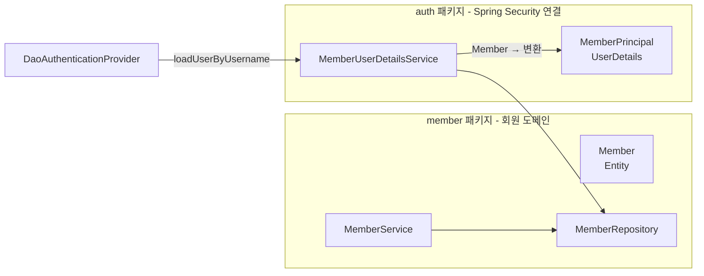

# 05. UserDetailsService 와 JPA 회원

## 학습 목표

- Spring Data JPA 로 회원 엔티티와 리포지토리를 만든다.
- `UserDetails` / `UserDetailsService` 를 구현해서 DB 회원으로 로그인할 수 있게 한다.
- `AuthenticationManager` 를 빈으로 등록하는 이유를 안다.
- 회원가입 기능을 만든다.

## 1. 전체 구조



**회원 도메인(`member`)은 Spring Security 를 모른다.** Security 와의 연결은 `auth` 패키지가 담당한다.
도메인 로직과 보안 프레임워크를 분리해 두면 각각을 독립적으로 바꾸고 테스트하기 쉽다.

## 2. 회원 엔티티와 리포지토리

[`Member.java`](../src/main/java/com/example/security/member/Member.java)

```java
@Entity
@Table(name = "members")
public class Member {

    @Id
    @GeneratedValue(strategy = GenerationType.IDENTITY)
    private Long id;

    @Column(nullable = false, unique = true, length = 50)
    private String username;

    /** 평문이 아닌 PasswordEncoder 로 인코딩된 값만 저장한다. */
    @Column(nullable = false)
    private String password;

    @Column(nullable = false, length = 50)
    private String nickname;

    @Enumerated(EnumType.STRING)
    @Column(nullable = false, length = 20)
    private Role role;

    @Column(nullable = false, updatable = false)
    private Instant createdAt;

    protected Member() { }   // JPA 용

    public static Member create(String username, String encodedPassword, String nickname, Role role) { ... }
    // getter 만 있고 setter 는 없다
}
```

- `username` 에 **유니크 제약**을 건다. 같은 아이디가 두 개면 로그인할 때 누구인지 알 수 없다.
- 파라미터 이름을 `encodedPassword` 로 지어서 "인코딩된 값을 넣어야 한다" 는 것을 드러낸다.
- `Role` 은 `@Enumerated(EnumType.STRING)` 으로 저장한다. `ORDINAL`(숫자) 은 enum 순서가 바뀌면 데이터가 꼬인다.

[`Role.java`](../src/main/java/com/example/security/member/Role.java)

```java
public enum Role {
    USER,
    ADMIN;

    public String authority() {
        return "ROLE_" + name();   // Spring Security 의 Role 규칙 (07장)
    }
}
```

[`MemberRepository.java`](../src/main/java/com/example/security/member/MemberRepository.java)

```java
public interface MemberRepository extends JpaRepository<Member, Long> {
    Optional<Member> findByUsername(String username);
    boolean existsByUsername(String username);
}
```

메서드 이름만으로 Spring Data JPA 가 쿼리를 만들어 준다 (`select ... where username = ?`).

## 3. UserDetails - Spring Security 가 이해하는 사용자

Spring Security 는 우리 `Member` 엔티티를 모른다. 대신 `UserDetails` 라는 **약속된 형태**로 사용자를 받는다.

```java
public interface UserDetails extends Serializable {
    Collection<? extends GrantedAuthority> getAuthorities();
    String getPassword();
    String getUsername();
    default boolean isAccountNonExpired() { return true; }
    default boolean isAccountNonLocked() { return true; }
    default boolean isCredentialsNonExpired() { return true; }
    default boolean isEnabled() { return true; }
}
```

[`MemberPrincipal.java`](../src/main/java/com/example/security/auth/MemberPrincipal.java)

```java
public record MemberPrincipal(
        Long id,
        String username,
        String password,
        String nickname,
        Role role
) implements UserDetails {

    public static MemberPrincipal from(Member member) { ... }

    @Override
    public Collection<? extends GrantedAuthority> getAuthorities() {
        return List.of(new SimpleGrantedAuthority(role.authority()));  // ROLE_USER / ROLE_ADMIN
    }

    @Override
    public String toString() {
        // 비밀번호 해시가 로그에 찍히지 않도록 한다
        return "MemberPrincipal[id=%d, username=%s, role=%s]".formatted(id, username, role);
    }
}
```

**왜 `Member` 엔티티에 `UserDetails` 를 직접 구현하지 않을까?**

| `Member implements UserDetails` 의 문제 | `MemberPrincipal` (record) 로 분리하면 |
|---|---|
| 인증 객체는 **세션에 저장(직렬화)** 된다. 엔티티의 지연 로딩 프록시가 함께 직렬화되면 문제가 생긴다. | 필요한 값만 담은 불변 객체라 안전하다. |
| 도메인 엔티티가 Spring Security 에 의존하게 된다. | 도메인과 보안이 분리된다. |
| 세션에 든 엔티티를 수정하면 영속성 컨텍스트 밖이라 혼란스럽다. | record 라 수정 자체가 불가능하다. |

> `isAccountNonLocked()` 등은 기본값 `true` 를 그대로 쓴다. "5회 실패 시 계정 잠금" 같은 기능이 필요하면
> `Member` 에 상태 컬럼을 추가하고 이 메서드들을 구현하면 된다. `DaoAuthenticationProvider` 가 알아서 검사한다.

## 4. UserDetailsService - username 으로 사용자 찾기

[`MemberUserDetailsService.java`](../src/main/java/com/example/security/auth/MemberUserDetailsService.java)

```java
@Service
public class MemberUserDetailsService implements UserDetailsService {

    private final MemberRepository memberRepository;

    @Override
    @Transactional(readOnly = true)
    public UserDetails loadUserByUsername(String username) throws UsernameNotFoundException {
        return memberRepository.findByUsername(username)
                .map(MemberPrincipal::from)
                .orElseThrow(() -> new UsernameNotFoundException("User not found: " + username));
    }
}
```

**비밀번호 비교는 여기서 하지 않는다!** `UserDetailsService` 는 사용자를 찾아서 돌려주기만 하고,
비교는 `DaoAuthenticationProvider` 가 `PasswordEncoder` 로 한다 (03장의 시퀀스 다이어그램 참고).

> **보안 포인트**: `UsernameNotFoundException` 을 던져도 사용자에게는 "아이디 또는 비밀번호가 올바르지 않습니다" 만 보인다.
> `DaoAuthenticationProvider` 가 이를 `BadCredentialsException` 으로 바꾸기 때문이다.
> "없는 아이디입니다" 와 "비밀번호가 틀렸습니다" 를 구분해서 알려주면 공격자가 **가입된 아이디 목록을 알아낼 수 있다(계정 열거 공격).**
> 또한 사용자가 없을 때도 일부러 비밀번호 해시 비교를 수행해서, 응답 시간 차이로 아이디 존재 여부를 추측하는 것도 막는다.

## 5. AuthenticationManager 를 빈으로 등록하기

[`SecurityConfig.java`](../src/main/java/com/example/security/config/SecurityConfig.java)

```java
@Bean
public AuthenticationManager authenticationManager(UserDetailsService userDetailsService,
                                                   PasswordEncoder passwordEncoder) {
    DaoAuthenticationProvider provider = new DaoAuthenticationProvider(userDetailsService);
    provider.setPasswordEncoder(passwordEncoder);
    return new ProviderManager(provider);
}
```

사실 `UserDetailsService` 와 `PasswordEncoder` 빈만 있어도 Spring Security 가 내부적으로 똑같은 구성을 만들어 준다.
그런데도 직접 등록하는 이유는, **09장의 JWT 발급 API(`POST /api/auth/token`)에서 `AuthenticationManager` 를 주입받아 직접 인증을 수행**하기 때문이다.
빈으로 등록하면 폼 로그인과 토큰 발급 API 가 **같은 인증 로직**을 공유한다.

## 6. 회원가입

### 서비스

[`MemberService.java`](../src/main/java/com/example/security/member/MemberService.java)

```java
@Transactional
public Member register(String username, String rawPassword, String nickname, Role role) {
    if (memberRepository.existsByUsername(username)) {
        throw new DuplicateUsernameException(username);
    }
    Member member = Member.create(username, passwordEncoder.encode(rawPassword), nickname, role);
    return memberRepository.save(member);
}
```

### 입력 검증

[`SignupRequest.java`](../src/main/java/com/example/security/member/SignupRequest.java)

```java
public record SignupRequest(
        @NotBlank @Size(min = 4, max = 50)
        @Pattern(regexp = "^[a-z0-9_]+$", message = "영문 소문자, 숫자, _ 만 사용할 수 있습니다.")
        String username,

        @NotBlank @Size(min = 8, max = 64)
        @MaxBytes(BCRYPT_MAX_BYTES)          // 72
        String password,

        @NotBlank @Size(max = 50)
        String nickname
) { ... }
```

비밀번호에 **글자 수(`@Size`)와 바이트 수(`@MaxBytes`) 제한이 둘 다** 걸려 있다. 이유가 있다.

> **실제로 겪은 버그**: Spring Security 7 의 `BCryptPasswordEncoder` 는 **72바이트를 넘는 비밀번호를 받으면 `IllegalArgumentException` 을 던진다.**
> 한글은 UTF-8 로 한 글자에 3바이트라서 `@Size(max = 64)` 만 있으면 한글 30글자(90바이트) 비밀번호가 검증을 통과하고,
> 인코딩하는 순간 예외가 터져 500 에러가 난다.
> 그래서 바이트 길이를 검사하는 커스텀 검증 애너테이션 [`@MaxBytes`](../src/main/java/com/example/security/member/MaxBytes.java) 를 만들어 400 으로 막았다.
> 로그인 쪽은 `matches()` 가 예외 없이 `false` 를 반환하므로 문제가 없다.
> 이 동작은 `PasswordEncoderTest`, `ApiSecurityTest` 에 테스트로 남겨 두었다.

### 컨트롤러

[`AuthController.java`](../src/main/java/com/example/security/web/AuthController.java)

```java
@PostMapping("/signup")
public String signup(@Valid @ModelAttribute("form") SignupRequest form, BindingResult bindingResult) {
    if (bindingResult.hasErrors()) {
        return "signup";                               // 검증 실패 → 폼 다시 보여주기
    }
    try {
        memberService.signup(form);
    } catch (DuplicateUsernameException e) {
        bindingResult.rejectValue("username", "duplicate", e.getMessage());
        return "signup";
    }
    return "redirect:/login?signup";                   // 성공 → 로그인 화면으로
}
```

`/signup` 은 `SecurityConfig` 에서 `permitAll()` 로 열어 두었다. 로그인하지 않은 사람이 가입하는 화면이니까.

### 관리자 계정 자동 생성

[`AdminInitializer.java`](../src/main/java/com/example/security/member/AdminInitializer.java) 는 기동 시 관리자 계정이 없으면 만든다.
계정 정보는 [`AdminProperties`](../src/main/java/com/example/security/member/AdminProperties.java) 로 `application.yml` 의 `app.admin.*` 를 읽고,
값은 `APP_ADMIN_USERNAME`, `APP_ADMIN_PASSWORD` 환경 변수로 바꿀 수 있다.

## 직접 해보기

1. http://localhost:8080/signup 에서 `alice` / `password1234` 로 가입하고 로그인해 보자.
2. 같은 아이디로 다시 가입해 보자. 어떤 메시지가 나오는가?
3. 존재하지 않는 아이디와 틀린 비밀번호로 각각 로그인해 보자. 에러 메시지가 같은가?
4. (도전) `Member` 에 `boolean locked` 컬럼을 추가하고 `MemberPrincipal#isAccountNonLocked()` 를 구현해 보자. 잠긴 계정은 로그인이 거부되는가?

## 정리

- Spring Security 는 `UserDetails` 로 사용자를, `UserDetailsService` 로 사용자 조회 방법을 전달받는다.
- 엔티티와 인증 객체(`MemberPrincipal`)를 분리하면 세션 직렬화와 계층 분리 측면에서 안전하다.
- 비밀번호 비교는 `DaoAuthenticationProvider` + `PasswordEncoder` 의 몫이다.
- `AuthenticationManager` 를 빈으로 등록하면 폼 로그인과 API 가 같은 인증 로직을 재사용할 수 있다.

---

| 이전 | 목차 | 다음 |
|:-----|:----:|-----:|
| [← 04. PasswordEncoder](04-password-encoder.md) | [목차](../README.md) | [06. 폼 로그인과 로그아웃 →](06-form-login.md) |
