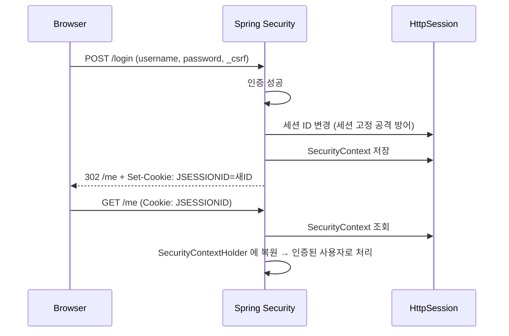

# 06. 폼 로그인과 로그아웃

## 학습 목표

- 커스텀 로그인 페이지를 연결하고, `POST /login` 을 누가 처리하는지 안다.
- 로그인 후 인증 정보가 세션에 저장되는 과정을 이해한다.
- 컨트롤러와 템플릿에서 현재 로그인한 사용자를 꺼내 쓸 수 있다.
- 로그아웃이 왜 POST 여야 하는지 안다.

## 1. 웹 SecurityFilterChain

[`SecurityConfig.java`](../src/main/java/com/example/security/config/SecurityConfig.java)

```java
@Bean
@Order(2)
public SecurityFilterChain webSecurityFilterChain(HttpSecurity http) throws Exception {
    http
            .authorizeHttpRequests(auth -> auth
                    .requestMatchers(PathRequest.toStaticResources().atCommonLocations()).permitAll()
                    .requestMatchers("/", "/login", "/signup", "/error", "/access-denied").permitAll()
                    .requestMatchers("/admin/**").hasRole("ADMIN")
                    .anyRequest().authenticated()
            )
            .formLogin(form -> form
                    .loginPage("/login")
                    .defaultSuccessUrl("/me")
                    .permitAll()
            )
            .logout(logout -> logout
                    .logoutSuccessUrl("/?logout")
            )
            .exceptionHandling(ex -> ex
                    .accessDeniedPage("/access-denied")
            );
    return http.build();
}
```

`authorizeHttpRequests` 는 07장에서 자세히 다루고, 이 장에서는 `formLogin` 과 `logout` 에 집중한다.

- `PathRequest.toStaticResources().atCommonLocations()` : `/css/**`, `/js/**`, `/images/**`, `/favicon.ico` 등 정적 리소스를 한 번에 허용한다.
- `/error` 를 허용하는 이유: 에러가 났을 때 Spring Boot 가 `/error` 로 포워드하는데, 이게 막혀 있으면 진짜 에러 대신 로그인 페이지가 보여서 디버깅이 어려워진다.

## 2. 로그인 페이지

`formLogin()` 의 옵션과 기본값:

| 설정 | 의미 | 우리 값 / 기본값 |
|------|------|------------------|
| `loginPage("/login")` | 로그인 **화면** URL | `/login` (우리가 만든 화면) |
| `loginProcessingUrl(...)` | 로그인 **처리** URL (폼의 action) | 기본값 = `loginPage` 와 같은 URL 에 대한 POST |
| `usernameParameter` / `passwordParameter` | 폼 필드 이름 | 기본값 `username` / `password` |
| `defaultSuccessUrl("/me")` | 로그인 성공 후 이동 | `/me` |
| `failureUrl(...)` | 로그인 실패 시 이동 | 기본값 `/login?error` |

화면은 우리가 만들지만, **로그인 처리는 우리가 만들지 않는다.**

[`AuthController.java`](../src/main/java/com/example/security/web/AuthController.java)

```java
/** 로그인 "화면" 만 담당한다. POST /login 처리는 UsernamePasswordAuthenticationFilter 가 한다. */
@GetMapping("/login")
public String loginForm() {
    return "login";
}
```

[`login.html`](../src/main/resources/templates/login.html)

```html
<p class="message" th:if="${param.signup}">회원가입이 완료되었습니다. 로그인해 주세요.</p>
<p class="error" th:if="${param.error}">아이디 또는 비밀번호가 올바르지 않습니다.</p>

<form th:action="@{/login}" method="post">
    <input id="username" name="username" type="text" autocomplete="username" required autofocus>
    <input id="password" name="password" type="password" autocomplete="current-password" required>
    <button type="submit">로그인</button>
</form>
```

`POST /login` 요청은 컨트롤러에 도착하기 전에 `UsernamePasswordAuthenticationFilter` 가 가로채서
`username`, `password` 파라미터로 인증을 수행한다 (03장 4절의 흐름).

`th:action` 을 쓰면 Thymeleaf 가 CSRF 토큰 hidden 필드를 **자동으로** 넣어준다 (08장).

### 원래 가려던 페이지로 돌아가기

로그인하지 않은 상태로 `/admin/members` 에 접근하면 로그인 페이지로 이동한다. 로그인에 성공하면 `/me` 가 아니라 **원래 가려던 `/admin/members?continue`** 로 돌아간다.
(`?continue` 는 Spring Security 가 "저장해 둔 요청으로 돌아가는 중" 임을 표시하려고 붙이는 파라미터다. 신경 쓰지 않아도 된다.)

`ExceptionTranslationFilter` 가 로그인 페이지로 보내기 전에 원래 요청을 `RequestCache`(세션)에 저장해 두기 때문이다.
`defaultSuccessUrl("/me")` 는 "저장된 요청이 없을 때" 의 기본 이동 위치다. 항상 `/me` 로 보내고 싶다면 `defaultSuccessUrl("/me", true)` 로 설정한다.

## 3. 로그인 성공 후 일어나는 일 - 세션



- 인증 결과는 `HttpSession` 에 저장되고, 브라우저는 `JSESSIONID` 쿠키로 자기 세션을 가리킨다.
- 다음 요청부터는 `SecurityContextHolderFilter` 가 세션에서 `SecurityContext` 를 꺼내 복원한다. 그래서 매번 로그인할 필요가 없다.
- **세션 고정 공격(Session Fixation) 방어**: 로그인 성공 시 세션 ID 를 새로 발급한다. 공격자가 미리 심어 둔 세션 ID 로는 로그인된 세션을 가로챌 수 없다. 기본으로 켜져 있다.

## 4. 현재 사용자 꺼내기

### (1) 컨트롤러 - @AuthenticationPrincipal

[`HomeController.java`](../src/main/java/com/example/security/web/HomeController.java)

```java
@GetMapping("/me")
public String me(@AuthenticationPrincipal MemberPrincipal principal, Model model) {
    model.addAttribute("me", principal);
    return "me";
}
```

`Authentication#getPrincipal()` 이 반환하는 객체(05장에서 만든 `MemberPrincipal`)를 바로 주입받는다.
`SecurityContextHolder.getContext().getAuthentication().getPrincipal()` 을 직접 호출하고 캐스팅하는 것보다 훨씬 깔끔하다.

### (2) 템플릿 - Thymeleaf Spring Security Extras

[`fragments/nav.html`](../src/main/resources/templates/fragments/nav.html)

```html
<html xmlns:th="http://www.thymeleaf.org"
      xmlns:sec="http://www.thymeleaf.org/extras/spring-security">

<!-- 로그인하지 않은 사용자에게만 보인다 -->
<th:block sec:authorize="isAnonymous()">
    <a th:href="@{/login}">로그인</a>
</th:block>

<!-- 로그인한 사용자에게만 보인다 -->
<th:block sec:authorize="isAuthenticated()">
    <a sec:authorize="hasRole('ADMIN')" th:href="@{/admin/members}">회원 관리</a>
    <span><b sec:authentication="name">user</b> 님</span>
</th:block>
```

| 속성 | 의미 |
|------|------|
| `sec:authorize="표현식"` | 표현식이 참일 때만 요소를 렌더링 |
| `sec:authentication="속성"` | `Authentication` 객체의 속성 값 출력 (`name`, `principal.nickname` 등) |

> **주의**: `sec:authorize` 로 메뉴를 숨기는 것은 **화면 편의 기능일 뿐 보안이 아니다.**
> 링크를 숨겨도 URL 을 직접 입력하면 접근할 수 있다. 실제 차단은 반드시 서버(`authorizeHttpRequests`, `@PreAuthorize`)에서 해야 한다.

### Spring Security 7 의 FACTOR 권한

`admin` 으로 로그인해서 `/me` 화면의 두 번째 표를 보자.

| 항목 | 값 |
|------|----|
| `principal.authorities` | `[ROLE_ADMIN]` |
| `authorities` | `[ROLE_ADMIN, FactorGrantedAuthority [authority=FACTOR_PASSWORD, issuedAt=2026-10-13T03:36:00.265146Z]]` |

`MemberPrincipal` 이 가진 권한은 `ROLE_ADMIN` 하나인데, `Authentication#getAuthorities()` 에는 `FACTOR_PASSWORD` 라는 권한이 하나 더 들어 있다.
`issuedAt` 은 그 인증 수단으로 **언제** 인증했는지를 기록한 값이다.
Spring Security 7 부터는 **"어떤 수단으로 인증했는지"** 를 나타내는 `FACTOR_*` 권한이 자동으로 추가된다.
비밀번호 + OTP 같은 다중 인증(MFA)을 구성할 때 "비밀번호 인증과 OTP 인증을 모두 마친 사용자만 허용" 같은 규칙을 만들기 위한 것이다.
지금은 "이런 게 있다" 정도만 알아두자. 09장에서 이 권한이 JWT 에 섞여 들어가지 않도록 처리한다.

## 5. 로그아웃

```html
<!-- 로그아웃은 반드시 POST + CSRF 토큰 -->
<form th:action="@{/logout}" method="post">
    <button type="submit">로그아웃</button>
</form>
```

`LogoutFilter` 가 `POST /logout` 을 가로채서 다음을 처리한다.

1. 세션 무효화 (`HttpSession#invalidate`)
2. `SecurityContextHolder` 비우기
3. `logoutSuccessUrl("/?logout")` 로 리다이렉트

**왜 GET 이 아니라 POST 일까?** GET 으로 로그아웃이 된다면 악성 사이트가 `` 한 줄만 심어도
방문자를 강제로 로그아웃시킬 수 있다. 상태를 바꾸는 요청은 POST + CSRF 토큰으로 보호한다 (08장).

## 직접 해보기

### 브라우저

1. 로그아웃 상태에서 http://localhost:8080/admin/members 접속 → 로그인 → `admin` 으로 로그인하면 어디로 이동하는가?
2. 개발자 도구(Application > Cookies) 에서 로그인 **전후의** `JSESSIONID` 값을 비교해 보자. 바뀌었는가?
3. `/me` 화면에서 1) 과 2) 의 값을 비교해 보자.

### curl 로 폼 로그인 해보기

```bash
# 1. 로그인 페이지를 받으면서 세션 쿠키와 CSRF 토큰을 얻는다
CSRF=$(curl -s -c cookies.txt http://localhost:8080/login \
  | grep -o 'name="_csrf" value="[^"]*"' | sed 's/.*value="//;s/"//')

# 2. 로그인
curl -s -b cookies.txt -c cookies.txt -o /dev/null -w '%{http_code} -> %{redirect_url}\n' \
  -d "username=admin&password=admin1234&_csrf=$CSRF" http://localhost:8080/login
# 302 -> http://localhost:8080/me

# 3. 세션 쿠키로 보호된 페이지 접근
curl -s -b cookies.txt -o /dev/null -w '%{http_code}\n' http://localhost:8080/admin/members
# 200
```

`-d` 에서 `_csrf` 를 빼고 2번을 실행하면 어떻게 될까? 08장에서 확인한다.

## 정리

- 로그인 **화면**은 우리가 만들고, 로그인 **처리**(`POST /login`)는 `UsernamePasswordAuthenticationFilter` 가 한다.
- 인증 결과는 세션에 저장되며, 로그인 시 세션 ID 가 바뀌어 세션 고정 공격을 막는다.
- 현재 사용자는 `@AuthenticationPrincipal` (컨트롤러), `sec:authorize` / `sec:authentication` (템플릿)으로 꺼낸다.
- 로그아웃은 POST 로 한다.

---

| 이전 | 목차 | 다음 |
|:-----|:----:|-----:|
| [← 05. UserDetailsService 와 JPA 회원](05-userdetails-jpa.md) | [목차](../README.md) | [07. 인가 - URL 과 메서드 보안 →](07-authorization.md) |
