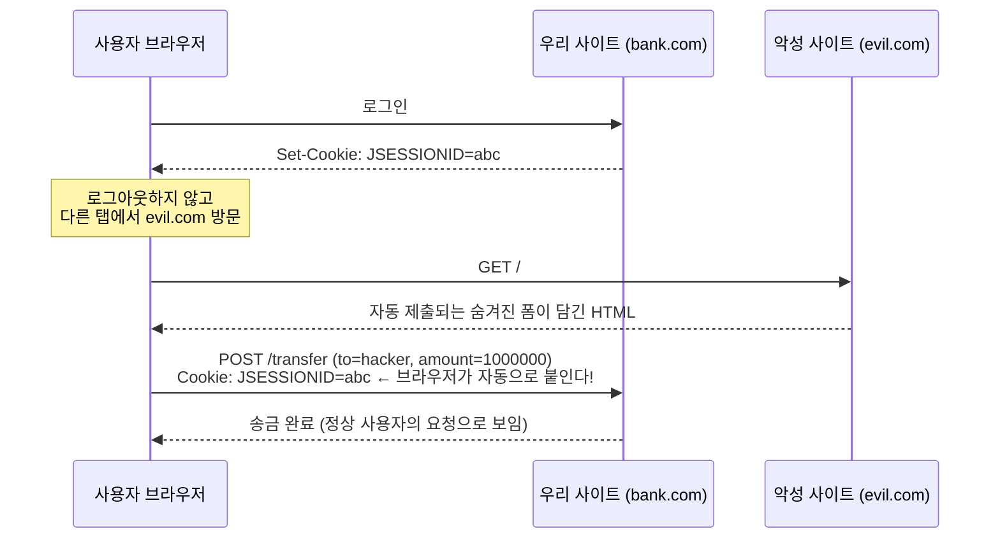

# 08. CSRF - 사이트 간 요청 위조

## 학습 목표

- CSRF 공격이 어떻게 동작하는지 설명할 수 있다.
- Spring Security 가 CSRF 토큰으로 이를 막는 원리를 안다.
- 웹 체인에서는 켜고 API 체인에서는 끄는 이유를 설명할 수 있다.

## 1. CSRF 공격이란

**CSRF (Cross-Site Request Forgery)** 는 사용자가 로그인된 상태를 악용해서, **사용자 몰래** 우리 사이트에 요청을 보내게 만드는 공격이다.



evil.com 에 숨겨진 코드는 이런 식이다.

```html
<form action="https://bank.com/transfer" method="post">
    <input type="hidden" name="to" value="hacker">
    <input type="hidden" name="amount" value="1000000">
</form>
<script>document.forms[0].submit();</script>
```

핵심은 **브라우저가 쿠키를 자동으로 붙여 보낸다**는 점이다. 서버 입장에서는 정상 사용자의 요청과 구별할 수 없다.

## 2. 방어: CSRF 토큰 (Synchronizer Token Pattern)

"evil.com 은 **알 수 없는** 값을 요청에 포함시키도록 요구하자" 가 아이디어다.

1. 서버가 세션마다 예측 불가능한 **CSRF 토큰**을 만들어 세션에 저장한다.
2. 우리 사이트의 폼에는 이 토큰을 hidden 필드로 넣어 둔다.
3. 상태를 바꾸는 요청(POST, PUT, PATCH, DELETE)이 오면 `CsrfFilter` 가 **요청의 토큰 == 세션의 토큰** 인지 확인한다. 다르거나 없으면 403.

evil.com 은 같은 출처 정책(Same-Origin Policy) 때문에 우리 사이트의 HTML 을 읽을 수 없으므로 토큰 값을 알 수 없다. 그래서 위조 요청은 실패한다.

GET, HEAD, OPTIONS, TRACE 는 검사하지 않는다. 이런 요청은 **상태를 바꾸지 않아야 한다**는 HTTP 규칙을 지킨다는 전제다.
"GET /delete?id=1" 같은 API 를 만들면 CSRF 방어가 무력화되니 주의하자.

## 3. 우리 프로젝트에서의 CSRF

### 웹 체인 - 켜져 있다 (기본값)

`SecurityConfig` 의 웹 체인에는 CSRF 관련 코드가 **한 줄도 없다.** 기본으로 켜져 있기 때문이다. 03장의 필터 목록에 `CsrfFilter` 가 있었던 것을 떠올리자.

Thymeleaf 의 `th:action` 이 토큰을 자동으로 넣어 준다. 브라우저에서 로그인 페이지의 소스를 보면:

```html
<form action="/login" method="post">
    <input type="hidden" name="_csrf" value="0mWX6DQMsKmn..."/>   ← 자동 삽입
    <input id="username" name="username" ...>
    ...
</form>
```

그래서 [`login.html`](../src/main/resources/templates/login.html), [`signup.html`](../src/main/resources/templates/signup.html),
로그아웃 버튼([`nav.html`](../src/main/resources/templates/fragments/nav.html)) 모두 `th:action` 을 쓴다.
`th:action` 대신 일반 `action` 속성을 쓰면 토큰이 들어가지 않아 403 이 난다.

알아두면 좋은 동작:

- 토큰은 기본적으로 **세션**에 저장된다 (`HttpSessionCsrfTokenRepository`).
- 화면에 렌더링되는 토큰 값은 **요청마다 다르게 보인다.** BREACH 공격을 막기 위해 원래 토큰에 매번 랜덤 값을 XOR 해서 내보내기 때문이다 (`XorCsrfTokenRequestAttributeHandler`). 서버는 이를 풀어서 비교한다.
- 로그인에 성공하면 CSRF 토큰도 새로 발급된다.

### API 체인 - 꺼져 있다

[`ApiSecurityConfig.java`](../src/main/java/com/example/security/config/ApiSecurityConfig.java)

```java
// 쿠키(세션)를 쓰지 않으므로 CSRF 공격 대상이 아니다
.csrf(AbstractHttpConfigurer::disable)
.sessionManagement(session -> session.sessionCreationPolicy(SessionCreationPolicy.STATELESS))
```

CSRF 는 "브라우저가 인증 정보(쿠키)를 **자동으로** 붙여 보낸다" 는 점을 악용한다.
API 체인은 `Authorization: Bearer <토큰>` 헤더로 인증하는데, 이 헤더는 **브라우저가 자동으로 붙이지 않는다.** JavaScript 가 직접 넣어야 하고, evil.com 의 스크립트는 우리 토큰을 모른다.
그래서 API 체인에서는 CSRF 방어가 필요 없다.

> **주의**: JWT 를 **쿠키에 저장**하는 방식이라면 이야기가 달라진다. 쿠키는 자동으로 전송되므로 CSRF 방어를 다시 켜야 한다.
> "JWT 를 쓰니까 CSRF 끄면 된다" 가 아니라 "**자동 전송되는 인증 정보가 없으니** 끈다" 가 정확한 이유다.

## 4. 직접 해보기 - curl 로 CSRF 확인

### 토큰 없이 POST → 403

```bash
curl -s -o /dev/null -w '%{http_code}\n' \
  -d 'username=csrf_test&password=password1234&nickname=test' \
  http://localhost:8080/signup
# 403
```

### 토큰과 함께 POST → 성공

```bash
# 1. 회원가입 페이지를 받으면서 세션 쿠키와 토큰을 얻는다
CSRF=$(curl -s -c cookies.txt http://localhost:8080/signup \
  | grep -o 'name="_csrf" value="[^"]*"' | sed 's/.*value="//;s/"//')

# 2. 같은 세션(쿠키)과 토큰으로 요청
curl -s -b cookies.txt -o /dev/null -w '%{http_code} -> %{redirect_url}\n' \
  -d "username=csrf_test&password=password1234&nickname=test&_csrf=$CSRF" \
  http://localhost:8080/signup
# 302 -> http://localhost:8080/login?signup
```

### 쿠키 없이 토큰만 보내면?

```bash
curl -s -o /dev/null -w '%{http_code}\n' \
  -d "username=csrf_test2&password=password1234&nickname=test&_csrf=$CSRF" \
  http://localhost:8080/signup
# 403 - 토큰은 "세션에 저장된 값" 과 비교하므로, 세션이 다르면 실패한다
```

### API 는 토큰 없이도 된다

```bash
curl -s -X POST http://localhost:8080/api/members \
  -H 'Content-Type: application/json' \
  -d '{"username":"api_csrf","password":"password1234","nickname":"api"}'
# {"success":true, ...}
```

## 5. 참고: SPA(React, Vue) 에서 세션 + CSRF 를 쓰는 경우

SPA 가 세션 쿠키로 인증한다면 CSRF 를 켜야 하는데, 서버가 렌더링한 폼이 없으니 토큰을 받을 방법이 필요하다.
Spring Security 는 이 경우를 위한 설정을 제공한다.

```java
.csrf(csrf -> csrf.spa())
```

토큰을 `XSRF-TOKEN` 쿠키로 내려주고, 프런트엔드가 이 값을 읽어 `X-XSRF-TOKEN` 헤더로 다시 보내는 방식이다.
Axios 등 많은 HTTP 클라이언트가 이 규칙을 기본 지원한다. 이 강의의 범위를 넘어가므로 이름만 기억해 두자.

## 정리

- CSRF 는 브라우저가 쿠키를 **자동으로** 보내는 점을 악용한 공격이다.
- Spring Security 는 세션에 저장한 CSRF 토큰과 요청의 토큰을 비교해서 막는다. 기본으로 켜져 있다.
- Thymeleaf 의 `th:action` 이 토큰을 자동으로 넣어 준다.
- 자동 전송되는 인증 정보가 없는 Bearer 토큰 API 에서는 CSRF 를 꺼도 된다. 쿠키에 토큰을 저장한다면 다시 켜야 한다.

---

| 이전 | 목차 | 다음 |
|:-----|:----:|-----:|
| [← 07. 인가 - URL 과 메서드 보안](07-authorization.md) | [목차](../README.md) | [09. JWT 로 REST API 보호하기 →](09-jwt-rest-api.md) |
