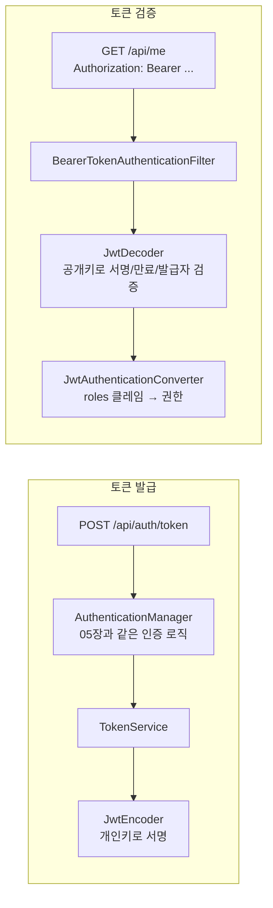

# 09. JWT 로 REST API 보호하기

## 학습 목표

- 세션 방식과 토큰 방식의 차이를 설명할 수 있다.
- JWT 의 구조를 알고, 서명이 무엇을 보장하는지 안다.
- Spring Security OAuth2 Resource Server 로 JWT 를 검증하는 API 체인을 구성한다.
- 아이디/비밀번호로 JWT 를 발급하는 API 를 만든다.

## 1. 세션 vs 토큰

| | 세션 (06장) | 토큰 (이번 장) |
|---|---|---|
| 인증 정보 저장 위치 | **서버** (HttpSession) | **클라이언트** (토큰 자체에 담김) |
| 클라이언트가 보내는 것 | `Cookie: JSESSIONID=...` | `Authorization: Bearer eyJ...` |
| 서버 확장 | 서버가 여러 대면 세션 공유 필요 (Redis 등) | 서명만 검증하면 되므로 어느 서버든 처리 가능 |
| 강제 로그아웃 | 세션 삭제로 즉시 가능 | 만료 전까지 유효 (별도 장치 필요) |
| 주 사용처 | 서버 렌더링 웹 | 모바일 앱, SPA, 서버 간 통신 |

## 2. JWT 구조

JWT(JSON Web Token)는 `.` 으로 구분된 세 부분으로 이루어진다.

```
eyJraWQiOiI4OGY5M2Jj...  .  eyJpc3MiOiJoZWxsby1zcHJpbmct...  .  Kx8b2Fp3...
└───── Header ─────┘       └──────── Payload ────────┘        └─ Signature ─┘
```

각 부분은 Base64URL 로 인코딩되어 있을 뿐이라 **누구나 디코딩해서 읽을 수 있다.** 우리 서버가 발급한 토큰의 Payload:

```json
{
  "iss": "hello-spring-security",
  "sub": "alice",
  "iat": 1791861738,
  "exp": 1791863538,
  "roles": ["ROLE_USER"]
}
```

| 클레임 | 의미 |
|--------|------|
| `iss` (issuer) | 발급자 |
| `sub` (subject) | 토큰의 주인. 우리는 username 을 넣는다 |
| `iat` / `exp` | 발급 시각 / 만료 시각 (Unix time) |
| `roles` | 우리가 추가한 커스텀 클레임. 권한 목록 |

**Signature** 는 Header + Payload 를 **서버의 개인키로 서명**한 값이다.
누군가 Payload 의 `roles` 를 `ROLE_ADMIN` 으로 바꾸면 서명이 맞지 않아 검증에 실패한다.

> JWT 는 **암호화가 아니라 서명**이다. 위변조는 막지만 내용은 다 보인다. 비밀번호나 주민번호 같은 민감 정보를 절대 넣지 말자.

## 3. 구성 요소 한눈에 보기



이 프로젝트는 토큰을 **발급하는 쪽과 검증하는 쪽을 한 애플리케이션에** 두었다. 실무에서는 보통 발급을 별도 인증 서버(Spring Authorization Server, Keycloak 등)가 맡고,
API 서버는 검증만 한다. 그때는 `JwtDecoder` 를 직접 만들 필요 없이 `spring.security.oauth2.resourceserver.jwt.issuer-uri` 설정 하나로 충분하다.

## 4. 서명 키와 Encoder / Decoder

[`JwtConfig.java`](../src/main/java/com/example/security/jwt/JwtConfig.java)

```java
@Bean
public KeyPair jwtKeyPair() {
    KeyPairGenerator generator = KeyPairGenerator.getInstance("RSA");
    generator.initialize(2048);
    return generator.generateKeyPair();
}

@Bean
public JwtEncoder jwtEncoder(KeyPair jwtKeyPair) {
    RSAKey rsaKey = new RSAKey.Builder((RSAPublicKey) jwtKeyPair.getPublic())
            .privateKey(jwtKeyPair.getPrivate())
            .keyID(UUID.randomUUID().toString())
            .build();
    return new NimbusJwtEncoder(new ImmutableJWKSet<>(new JWKSet(rsaKey)));
}

@Bean
public JwtDecoder jwtDecoder(KeyPair jwtKeyPair, JwtProperties properties) {
    NimbusJwtDecoder decoder = NimbusJwtDecoder.withPublicKey((RSAPublicKey) jwtKeyPair.getPublic()).build();
    // 서명 + 만료(exp) + 발급자(iss) 를 함께 검증한다
    decoder.setJwtValidator(JwtValidators.createDefaultWithIssuer(properties.issuer()));
    return decoder;
}
```

- **RSA(비대칭키)** 를 쓴다. 개인키로 서명하고 공개키로 검증한다. 검증하는 쪽은 공개키만 있으면 되므로 개인키를 나눠 줄 필요가 없다.
- 학습 편의를 위해 **기동할 때마다 키를 새로 만든다.** 그래서 서버를 재시작하면 기존 토큰은 모두 무효가 된다.
  운영에서는 키를 KMS, Vault 같은 곳에 보관하고 고정해서 쓴다.
- 비밀 문자열 하나로 서명하는 HMAC(HS256)도 가능하지만, 그 비밀값이 소스 코드나 설정 파일에 들어가기 쉽다. 이 프로젝트는 소스에 비밀값을 두지 않기 위해 RSA 를 선택했다.

## 5. 토큰 발급

[`TokenService.java`](../src/main/java/com/example/security/jwt/TokenService.java)

```java
public IssuedToken issue(Authentication authentication) {
    Instant now = Instant.now();
    Instant expiresAt = now.plus(properties.expiry());          // app.jwt.expiry: 30m
    List<String> roles = authentication.getAuthorities().stream()
            .map(GrantedAuthority::getAuthority)
            .filter(authority -> authority.startsWith(ROLE_PREFIX))
            .toList();

    JwtClaimsSet claims = JwtClaimsSet.builder()
            .issuer(properties.issuer())
            .issuedAt(now)
            .expiresAt(expiresAt)
            .subject(authentication.getName())
            .claim(JwtConfig.ROLES_CLAIM, roles)
            .build();
    JwsHeader header = JwsHeader.with(SignatureAlgorithm.RS256).build();

    String tokenValue = jwtEncoder.encode(JwtEncoderParameters.from(header, claims)).getTokenValue();
    return new IssuedToken(tokenValue, expiresAt);
}
```

> **`ROLE_` 필터링을 하는 이유 - 실제로 겪은 일**
> 처음에는 필터 없이 모든 권한을 넣었는데, 발급된 토큰을 디코딩해 보니 `"roles": ["ROLE_USER", "FACTOR_PASSWORD"]` 였다.
> 06장에서 본 Spring Security 7 의 `FACTOR_PASSWORD` 권한이 함께 들어간 것이다.
> 이 값은 "이번 요청에서 비밀번호로 인증했다" 는 뜻이라 토큰에 영구히 박아 둘 정보가 아니므로, 역할(`ROLE_*`)만 담도록 걸렀다.
> `ApiSecurityTest#토큰의_roles_클레임에는_ROLE_권한만_담긴다` 가 이를 검증한다.

[`AuthApiController.java`](../src/main/java/com/example/security/api/AuthApiController.java)

```java
@PostMapping("/token")
public ApiResponse<TokenResponse> token(@Valid @RequestBody TokenRequest request) {
    Authentication authentication = authenticationManager.authenticate(
            UsernamePasswordAuthenticationToken.unauthenticated(request.username(), request.password())
    );
    IssuedToken token = tokenService.issue(authentication);
    return ApiResponse.ok(new TokenResponse(token.value(), "Bearer", token.expiresAt()));
}
```

05장에서 빈으로 등록한 `AuthenticationManager` 를 여기서 직접 사용한다. 폼 로그인과 **완전히 같은 인증 로직**(MemberUserDetailsService + PasswordEncoder)을 거친다.
인증에 실패하면 `BadCredentialsException` 이 발생하고, [`ApiExceptionHandler`](../src/main/java/com/example/security/api/ApiExceptionHandler.java) 가 401 로 바꾼다.

## 6. 토큰 검증 - API SecurityFilterChain

[`ApiSecurityConfig.java`](../src/main/java/com/example/security/config/ApiSecurityConfig.java)

```java
@Bean
@Order(1)
public SecurityFilterChain apiSecurityFilterChain(HttpSecurity http,
                                                  JwtAuthenticationConverter jwtAuthenticationConverter)
        throws Exception {
    http
            .securityMatcher("/api/**")
            .authorizeHttpRequests(auth -> auth
                    .requestMatchers(HttpMethod.POST, "/api/auth/token", "/api/members").permitAll()
                    .requestMatchers("/api/admin/**").hasRole("ADMIN")
                    .anyRequest().authenticated()
            )
            .csrf(AbstractHttpConfigurer::disable)
            .sessionManagement(session -> session
                    .sessionCreationPolicy(SessionCreationPolicy.STATELESS)
            )
            .oauth2ResourceServer(oauth2 -> oauth2
                    .jwt(jwt -> jwt.jwtAuthenticationConverter(jwtAuthenticationConverter))
            );
    return http.build();
}
```

| 설정 | 의미 |
|------|------|
| `securityMatcher("/api/**")` + `@Order(1)` | `/api/**` 는 이 체인이 먼저 가져간다 (03장) |
| `STATELESS` | 세션을 만들지도, 사용하지도 않는다. 매 요청이 토큰만으로 인증된다 |
| `csrf.disable()` | 쿠키를 쓰지 않으므로 CSRF 대상이 아니다 (08장) |
| `oauth2ResourceServer().jwt()` | `BearerTokenAuthenticationFilter` 를 등록한다. `Authorization: Bearer` 헤더의 토큰을 `JwtDecoder` 로 검증한다 |

`formLogin` 을 설정하지 않았으므로 인증 실패 시 로그인 페이지로 리다이렉트하지 않고 **401** 을 응답한다.

### roles 클레임을 권한으로 바꾸기

`JwtDecoder` 가 검증을 마치면 `JwtAuthenticationConverter` 가 `Jwt` 를 `Authentication` 으로 바꾼다.
기본 동작은 `scope` 클레임을 읽어 `SCOPE_` 접두사를 붙이는 것(OAuth2 표준)이라, 우리 `roles` 클레임을 읽도록 바꿔 준다.

```java
@Bean
public JwtAuthenticationConverter jwtAuthenticationConverter() {
    JwtGrantedAuthoritiesConverter authoritiesConverter = new JwtGrantedAuthoritiesConverter();
    authoritiesConverter.setAuthoritiesClaimName("roles");   // scope → roles
    authoritiesConverter.setAuthorityPrefix("");              // SCOPE_ 접두사 없이 그대로

    JwtAuthenticationConverter converter = new JwtAuthenticationConverter();
    converter.setJwtGrantedAuthoritiesConverter(authoritiesConverter);
    return converter;
}
```

이제 `hasRole("ADMIN")`, `@PreAuthorize("hasRole('ADMIN')")` 가 웹과 API 에서 똑같이 동작한다.

### 컨트롤러에서 현재 사용자 꺼내기

[`MemberApiController.java`](../src/main/java/com/example/security/api/MemberApiController.java)

```java
/** JWT 인증에서는 principal 이 Jwt 객체다. sub 클레임 = username. */
@GetMapping("/me")
public ApiResponse<MemberResponse> me(@AuthenticationPrincipal Jwt jwt) {
    return ApiResponse.ok(memberService.findByUsername(jwt.getSubject()));
}
```

폼 로그인에서는 principal 이 `MemberPrincipal` 이었지만, JWT 인증에서는 `Jwt` 객체다. **인증 방식에 따라 principal 의 타입이 다르다**는 점에 주의하자.
한편 `authentication.name` 은 두 방식 모두 username 이므로 `MemberService` 의 `@PreAuthorize("#username == authentication.name ...")` 는 그대로 동작한다.

## 7. 직접 해보기 - curl 로 전체 흐름

```bash
# 1. 회원가입 (누구나)
curl -s -X POST http://localhost:8080/api/members \
  -H 'Content-Type: application/json' \
  -d '{"username":"alice","password":"password1234","nickname":"앨리스"}'
# {"success":true,"data":{"id":2,"username":"alice","nickname":"앨리스","role":"USER",...},"error":null}

# 2. 토큰 발급
TOKEN=$(curl -s -X POST http://localhost:8080/api/auth/token \
  -H 'Content-Type: application/json' \
  -d '{"username":"alice","password":"password1234"}' \
  | python3 -c 'import json,sys; print(json.load(sys.stdin)["data"]["accessToken"])')

# 3. Payload 디코딩해 보기 (누구나 읽을 수 있다!)
echo $TOKEN | cut -d. -f2 | tr '_-' '/+' | base64 -d 2>/dev/null; echo

# 4. 토큰으로 내 정보 조회
curl -s http://localhost:8080/api/me -H "Authorization: Bearer $TOKEN"
# {"success":true,"data":{"id":2,"username":"alice",...}}

# 5. USER 토큰으로 관리자 API → 403
curl -s -o /dev/null -w '%{http_code}\n' http://localhost:8080/api/admin/members \
  -H "Authorization: Bearer $TOKEN"
# 403

# 6. 다른 사람 정보 조회 → 403 (@PreAuthorize)
curl -s -o /dev/null -w '%{http_code}\n' http://localhost:8080/api/members/admin \
  -H "Authorization: Bearer $TOKEN"
# 403

# 7. 토큰 없이 → 401
curl -s -i http://localhost:8080/api/me | grep -iE '^HTTP|^www-auth'
# HTTP/1.1 401
# WWW-Authenticate: Bearer resource_metadata="http://localhost:8080/.well-known/oauth-protected-resource"
```

> 7번의 `resource_metadata` 는 Spring Security 7 에서 추가된 동작이다. 클라이언트에게 "이 API 의 인증 정보는 여기서 확인하라" 고
> OAuth 2.0 Protected Resource Metadata(RFC 9728) 위치를 알려준다. 03장의 필터 목록에 있던 `OAuth2ProtectedResourceMetadataFilter` 가 이 문서를 제공한다.

서버를 재시작한 뒤 같은 `$TOKEN` 으로 4번을 다시 호출해 보자. 키가 새로 만들어졌으므로 401 이 나온다.

## 8. 이 구현의 한계와 다음 단계

학습용으로 단순하게 만든 만큼 실무에서는 다음을 고려해야 한다.

| 한계 | 해결 방향 |
|------|-----------|
| 토큰을 만료 전에 무효화할 수 없다 | 만료 시간을 짧게(5~15분) + Refresh Token, 또는 토큰 블랙리스트 |
| 재시작하면 키가 바뀐다 | 키를 외부 저장소에 보관, JWK Set 엔드포인트로 공개키 배포 |
| 토큰 발급 로직을 직접 구현했다 | Spring Authorization Server 같은 표준 OAuth2 인증 서버 도입 |
| 로그인 시도 횟수 제한이 없다 | Rate limiting, 계정 잠금 (05장의 `isAccountNonLocked`) |

## 정리

- JWT 는 서명된(암호화되지 않은) 토큰이다. 서버는 서명, 만료, 발급자를 검증한다.
- `oauth2ResourceServer().jwt()` 한 줄로 Bearer 토큰 검증 필터가 구성된다.
- `JwtAuthenticationConverter` 로 커스텀 클레임을 권한으로 매핑하면 `hasRole` 과 `@PreAuthorize` 를 그대로 쓸 수 있다.
- 웹(세션)과 API(JWT)는 `securityMatcher` 와 `@Order` 로 나눈 별도의 체인이 담당한다.

---

| 이전 | 목차 | 다음 |
|:-----|:----:|-----:|
| [← 08. CSRF](08-csrf.md) | [목차](../README.md) | [10. 보안 테스트 →](10-testing.md) |
